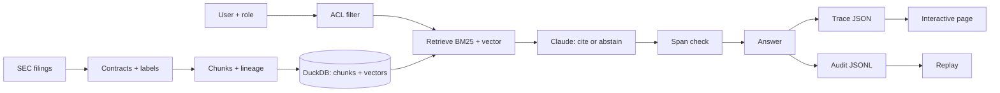

# Trust Pack: M0 audit and plan

Status: M0 done, waiting for PM approval. No pipeline code written.
Audited 2026-11-25. Public data only. Not investment advice.

**Decision first.** Build a small, new Trust Pack: public SEC filings as a family office "data room", three users with different rights, one cited answer per question, and one interactive page that walks a single question through all 12 layers. Reuse patterns from both repos, not their products. Keep it light: one process, no servers to run, Docker optional.

**Your two new asks, applied.** (1) Visual and interactive: the main deliverable becomes one static HTML page built from real run outputs, plus Mermaid diagrams in the Markdown files. (2) Lightweight: DuckDB in-process instead of Postgres, our own trace viewer instead of a 6-container Langfuse stack. Both are changes to the spec, flagged in section 5 for your yes or no.

## 1. What exists

| | lp-data-foundations (Portfolio Answer Desk) | lender-watch |
|---|---|---|
| What it is | **Not a data-room Q&A.** A test bench of 5 data setups on synthetic LP data, 60 questions | Matches PE-owned company names to public SEC BDC loan rows |
| Retriever | BM25 over whole documents (`foundations/search.py`), no chunks | Fuzzy + TF-IDF + embeddings over loan rows (`erm/retrieve.py`) |
| Vector store | None | None; vectors in memory (numpy) |
| Embeddings | None | Local `model2vec` potion-base-8M, CPU, no network after download |
| Chunker | None | None |
| Model + config | `llm.py`: Claude sonnet-5-5, live only with key AND `ANSWERDESK_LIVE=1` | `match/judge.py`: Claude opus-5-5, Pydantic output, cost per call |
| Contracts | Pydantic row contracts, failures in `silver.rejects` | Rows marked unusable with a reason, never dropped |
| Access | Roles; per-role DuckDB copy; search index built only from docs the role can see | Sign-in and invite list on the hosted service |
| Eval | 60-question harness, offline and live runs saved as JSON, eval gate test | Answer key, `evals/thresholds.yaml`, offline gate, weekly live judge check |
| Tracing | Langfuse, no-op without keys | Langfuse on judge calls, private OTel provider, no names sent |
| Audit | `governance.audit` to `logs/audit.jsonl` | Run records in SQLite |
| Tests | 64 pass | 375 pass |
| Docker, Makefile, CI | None | Dockerfile, compose (dev/prod), Makefile, 4 GitHub workflows, rollback script, secret scan |

**Docker here:** the daemon starts in this cloud container and pulled `pgvector/pgvector:pg16`. So `make demo` can be verified here. With the lightweight plan it does not need Docker at all.

## 2. What we reuse

| From | File | Use |
|---|---|---|
| lp-data-foundations | `foundations/search.py` | BM25 half of retrieval, ACL applied before scoring (same idea) |
| lp-data-foundations | `contracts.py`, `pipeline.py` (`_reject`, `silver.rejects`) | Doc contract pattern and reject log |
| lp-data-foundations | `llm.py` | One structured Claude call, two-switch live gate, offline path |
| lp-data-foundations | `governance.py` | Append-only JSONL audit |
| lp-data-foundations | `tracing.py` | No-op-without-keys pattern |
| lp-data-foundations | `static/foundations.html`, `explainer.py` | Interactive page built from real run JSON |
| lender-watch | `erm/connectors/bdc.py` | SEC provenance fields (adsh, cik, filed, url); structured truth for numeric golden answers |
| lender-watch | `erm/retrieve.py` | Local embedder (potion-base-8M) |
| lender-watch | `match/judge.py` | Pinned model, Pydantic output, cost per call |
| lender-watch | `evals/thresholds.yaml`, `.github/workflows/ci.yml` | Gate thresholds file, CI shape |
| lender-watch | `scripts/scan-secrets.sh`, `scripts/rollback.sh` | Key scan, one-command rollback idea |

## 3. Gaps against the 12 layers

| # | Layer | Exists? | Gap | Plan |
|---|---|---|---|---|
| 1 | Ingestion and contracts | Partial (rows) | No per-document contract, no SHA-256, no empty-page check | `DocRecord` Pydantic model; rejects to `rejects.jsonl` with reason |
| 2 | Classification and PII | No | No labels | Label per doc in a manifest; Presidio is stretch |
| 3 | Lineage | Partial (doc_id) | No chunk offsets or versions | Chunk = doc hash, page, char start/end, chunker, embedder, index versions |
| 4 | Sovereignty | No | No boundary config | `config/boundary.yaml` + `DATA_BOUNDARY.md`: local store, local embeddings, one outbound flow (model API) |
| 5 | Access control | Partial (roles) | Not at chunk retrieval | ACL as a `WHERE room IN (...)` inside the retrieval query; leak test |
| 6 | Retrieval | Partial (BM25) | No chunks, no vectors | BM25 + local vectors, merged; ACL first |
| 7 | Guardrails | Partial (number check, advice refusal) | No cite-or-abstain, no span check, no injection test | Structured answer: claims with chunk ID and quote; code checks each quote |
| 8 | Offline eval | Yes (other domain) | No RAG metrics | 40-question YAML golden set; recall@5, MRR, citation, abstention, access, faithfulness |
| 9 | Release gate | Partial (lender-watch) | No registry | `registry.yaml` with versions; gate script; CI runs offline eval; rollback = git revert of registry |
| 10 | Tracing | Partial (cloud Langfuse) | Not per layer | One trace JSON per request with every layer; Langfuse export optional |
| 11 | Audit and replay | Partial (audit) | No replay | Audit row holds versions + chunk IDs + chunk hashes; `make replay ID=...` |
| 12 | Runbook | No | | `RUNBOOK.md`, two loops (wrong answer, suspected leak) |

## 4. Repo decision

- **A. Inside lp-data-foundations** (new `trustpack/` package). Zero setup; but the repo's README, CLAUDE.md and case study are about a different product, so a CTO reading it sees two stories.
- **B. New repo `trust-pack`** that copies the small modules above with a note on where each came from. One story, clean clone, clean `make demo`.

**Recommendation: B.** I can't create repos from this session, so I build on the `trust-pack` branch here and move it with history once you create the empty repo.

## 5. M1 to M4 plan and first design choices

| M | Done when | Choice | Option 1 | Option 2 | Rec |
|---|---|---|---|---|---|
| M1 | Bad docs rejected with reason; every chunk has lineage; user A gets 0 chunks from room B | Store | DuckDB in-process (already used; nothing to run) | Postgres + pgvector in Docker (row-level security, as in the spec) | **1**: lighter; same SQL filter ports to Postgres RLS, stated in TRUST.md |
| M1 | | Embeddings | Local potion-base-8M (reused, no outbound) | Provider embedding API | **1**: keeps exactly one outbound flow |
| M1 | | Corpus | ~12 10-Q/10-K primary documents from 6 BDC filers, schedule-of-investments pages, 3 rooms | Structured `soi.tsv` only | **1** for text; `soi.tsv` checks numeric answers |
| M1 | | Rooms and users | Family office framing: "Principal" (all rooms), "Credit branch" (room A), "External adviser" (room C, public only) | Generic users A, B, C | **1**: matches your UAE family office story |
| M2 | `make eval` prints all metrics, saves a versioned run | Golden labels | Expected evidence as doc hash + quoted text (survives rechunking) | Expected chunk IDs | **1** |
| M2 | | Judge | Claude judge with a deterministic offline stand-in; you label 15 answers for calibration | Ragas | **1**; Ragas only as a cross-check |
| M3 | Cite-or-abstain, span check, advice refusal, injection pass in eval | Answer format | JSON claims `{text, chunk_id, quote}`, code checks quote is in chunk | Free text with `[c12]` markers | **1**: checkable by code |
| M3 | | Injection | Docs passed as data in tagged blocks + span check + planted-instruction test | Separate classifier model | **1** |
| M4 | One request end to end: trace, audit, replay, real numbers, TRUST.md, DEMO.md | Tracing | Own trace JSON + viewer in the page; Langfuse export if keys | Self-hosted Langfuse (6 containers) | **1**: lighter; self-hosted Langfuse moves to stretch. **Spec change, needs your yes** |
| M4 | | Visual deliverable | One static HTML page from real outputs: pick a user, ask, watch the 12 layers light up, see what each user could not see, eval scoreboard, UAE lens | Streamlit app | **1**: no server, works on GitHub Pages and offline in the interview |

**UAE family office lens (content for the page and TRUST.md, sources checked in M4):** UAE federal data protection law (PDPL) and the free-zone regimes (DIFC, ADGM) for where data sits and when it may leave; family branches and advisers as access groups; principals' personal data as the highest label; an in-region managed model endpoint swapped in by config only. Each point maps to a layer, so the page doubles as your study guide. No vendor, cloud provider or family office is named.

## 6. Name risks

- **lp-data-foundations:** all synthetic; audited 2026-10-25, no hits. Clean.
- **lender-watch:** real PE sponsors and portfolio companies (public sponsor sites and SEC filings, for example KnowBe4, Vista Equity Partners). Allowed as public data. `data/synthetic/companies.csv` puts real company names next to synthetic positions of a synthetic pension plan: not reused here.
- **lender-watch notes:** its name audit says a source document's title named an organisation you applied to; that title is not in the repo. Nothing to carry over.
- **Git history of both repos** shows a personal email as commit author. Not a company name; your call before going public.
- **Risk I can't check:** your employer, clients and the interviewer's company. Give me a list and I grep both repos and every Trust Pack file. Because of this I name no cloud provider anywhere.
- **Process note:** `CLAUDE.md` here says work on `build` and run autonomously; this task says `trust-pack` branch and stop per milestone. I followed the task.

## What you can now say in the interview

- "I audited my own two prototypes against a 12-layer control list before writing code: 5 layers existed in part, 3 not at all (sovereignty, replay, runbook), and I can show which file covers each."
- "Access is enforced inside the retrieval query, before the model sees anything; the test is that a user gets zero chunks from a room they can't see, even when the prompt asks for them."
- "The only data leaving the box is the model call: storage and embeddings are local, so moving to an in-region endpoint is a config change, and the boundary file proves it."
