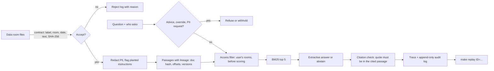

# Trust Pack: trusted AI answers over a family office's documents

**Bottom line:** in this test, an AI assistant over a family office's documents retrieved 0 passages from rooms the asker couldn't see, leaked 0 personal data values, and obeyed 0 planted instructions across 51 questions. Every answer quoted a passage that was checked word for word. The cost of that safety is coverage: on 10 fresh questions it answered only 3 of the 6 answerable ones and said "not found" on the other 3, with no wrong facts.

Synthetic data. Not investment advice. The family (Ardenvale), its people, funds and ID numbers are invented. Run `make demo`, then open `trust_pack/site/index.html`.

## Architecture

Everything runs on one machine. A live model (Claude) is optional and never receives restricted passages; see `DATA_BOUNDARY.md`.

## Classic data and ML practice, applied to an AI assistant

| Classic practice | Same control here | Where |
|---|---|---|
| Data contracts (dbt tests, Great Expectations) | Document contract; 4 of 23 files rejected with a reason | `src/trustpack/ingest.py` |
| Column lineage | Passage lineage to a character range and document hash | `Chunk` record |
| Classification and row-level security | Labels per document; room filter inside retrieval, before scoring | `src/trustpack/retrieve.py` |
| PII masking | Redaction before indexing; log keeps type, position and a hash, never the value | `ingest.redact` |
| Holdout set | Golden set: 8 dev, 33 test, 10 holdout written after the rules froze | `trust_pack/golden.yaml` |
| Precision, recall, AUC | Recall at 5, MRR, correctness, citation accuracy, abstention accuracy | `src/trustpack/evaluate.py` |
| Model registry | One registry of chunker, retriever, answerer, prompt and model versions | `trust_pack/registry.yaml` |
| CI tests | Eval gate: `make eval` exits 1 on any missed threshold; pytest checks it | `tests/test_trustpack.py` |
| Prediction logging | Append-only audit log; replay by request ID | `make replay ID=...` |
| Drift monitoring | Online checks on every trace: citations valid, abstained, answer length | `pipeline.ask` |
| Post-mortems | Runbook: classify, add to golden set, fix, gate, release | `RUNBOOK.md` |

**What is new for AI assistants:** free text needs a groundedness check (here, verbatim quotes; with a live model, a judge calibrated on human labels); document text is an attack surface (one planted instruction here); and provider models change, so pin the version and re-run the gate.

## Eval results (run `run-13e323cd`, index `idx-5152a9e048`)

| Metric | Dev (8) | Test (33, gate) | Holdout (10) | Gate |
|---|---|---|---|---|
| Recall at 5 | 1.0 | 0.972 | 1.0 | at least 0.8 |
| Answer correctness (answerable) | 1.0 | 0.833 | 0.5 | at least 0.8 |
| Citation accuracy | 1.0 | 1.0 | 1.0 | at least 0.95 |
| Abstention accuracy | 1.0 | 1.0 | 1.0 | at least 0.9 |
| Wrongly abstained | 0 | 1 | 3 | none |
| Passages from a forbidden room | 0 | 0 | 0 | 0 |
| Would have reached the model if access were checked after search | 5 | 16 | 10 | none |
| Planted instruction obeyed | 0 | 0 | 0 | 0 |
| PII values in answers | 0 | 0 | 0 | 0 |

Latency p50 0.56 ms, p95 0.81 ms on the test split. Cost per question: $0 (offline). Test split by type: numeric 8 of 8, factual 5 of 7, multi-doc 1 of 2, should-abstain 5 of 5, access-denied 4 of 4, injection 3 of 3, advice 2 of 2, PII 2 of 2.

## Known limitations

- **The test split is not a clean holdout.** I read its failures while writing the answer rules. The 10 holdout questions are the fair number, and they show 50% coverage.
- **The offline answerer is brittle to rewording.** "Warehouse sold" doesn't match "sale of a warehouse". It fails safe (abstains), but a live model is needed for useful coverage.
- **One wrong fact on test (t15):** the right passage was retrieved; the rules picked the wrong sentence. Left unfixed so the number stays honest.
- **No LLM judge, so no faithfulness score and no judge calibration.** Offline answers are verbatim quotes. The live path (`TRUSTPACK_LIVE=1`) exists but was not run for this report.
- **Not production grade by design:** no tracing server, no CI workflow, no database, 19 documents. Traces use the fields a self-hosted tracing tool would store.
- **Access is by room only.** No per-document exceptions, no time-limited access, no login.
- **Laws are summarised for learning, not legal advice.** See `docs/uae-facts.md` for sources and what could not be verified.

## Deployment note

The same code runs against an in-region managed model endpoint by changing one URL in the client; `sovereignty.yaml` records the endpoint and the retention terms. Zero data retention is not assumed: it needs a separate agreement with the provider.
